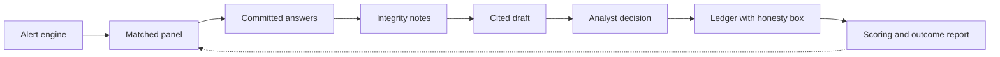

# Sealed Signals

Sealed Signals is the Risk Radar platform ACAPS does not have: the live Risk List from the ACAPS API, with an expert loop,
descriptive integrity notes and a public audit trail on top. An ACAPS analyst (or, in phase 2, an indicator doorbell)
sends a one-minute question to the eight best-matched vetted experts. Experts answer on their phone behind a mask they
choose, with ACAPS's rating hidden until after submission. Answers are committed with a timestamp, opened together,
summarised as an equal-weight mean with spread and minority reasons, annotated with integrity notes the analyst reads,
turned into a cited draft the analyst accepts, edits or rejects, and published as a group view on a ledger with an honesty
box that states what fed into it, its limits and its misses. When the risk resolves, forecasts are scored committee-side
and every panel member gets the group outcome report. Nothing publishes itself.

*The machine rings the doorbell, the panel answers, the analyst decides, the ledger remembers.*

Challenge: ACAPS "Ground Truth", Hackathon for Good #8, The Hague, 6-8 Nov 2026. Demo risk: R1043, escalating cross-border insecurity in eastern Chad.

## Why

ACAPS rates risks on probability and impact. Among the 104 resolved risks in the Risk Radar export, 32 of 38 High-rated risks materialised (84 %), but only 27 of 58 Medium-rated risks did (47 %). A Medium rating is close to a coin flip, and a reader cannot tell how it was reached or how often the ratings are right.

What we learned from ACAPS on 6 Nov:
- Experts are informed professionals who already track crises, not sources on the ground. They are matched on geography and theme, and a committee approves them.
- 32 analysts track their countries daily, score risks by hand and update weekly.
- There is no platform. Risk Radar is a dataset and an API.
- A panel could lean one way. The tool must be one validation layer among others, products never change automatically, and ACAPS must say what fed into each product. In the mentor's words: "We will get things wrong, like a prediction market; the point is honesty about it."

Sealed Signals is our answer: a loop that asks the right people at the right moment, keeps a verifiable record of what they said and when, leaves the decision to the analyst, and publishes its own limits and misses.

More: [impact](docs/sealed-signals/impact.md) | [integrity and honesty](docs/sealed-signals/bias-and-honesty.md) | [trust design](docs/sealed-signals/trust-design.md) | [privacy engineering](docs/sealed-signals/privacy-engineering.md) | [question contract](docs/sealed-signals/question-contract.md) | [judging checklist](docs/sealed-signals/judging-checklist.md) | [demo script](docs/sealed-signals/demo-script.md) | [future work](docs/sealed-signals/future.md)

## How it works



1. **Alert.** The Risk Alert Engine diffs ACAPS's own monthly INFORM Severity and humanitarian access editions for every crisis, ranks the moves, links them to active risks (the analyst confirms each link) and shows the rule that fired. The analyst approves a pulse or dismisses it with a note. It is arithmetic on ACAPS data, with no model. The analyst can also ask the panel directly. In the April 2026 replay, the Sudan-to-Chad displacement crisis (TCD005) rose from 6.1 to 6.9, the largest rise of 123 crises, and is linked to R1043. External feeds (ACLED, UNHCR, GDELT) are a later addition.
2. **Matched panel.** Up to 8 approved experts, picked by geographic and thematic tags, with no more than 3 from one affiliation type.
3. **Committed answers.** One card, about a minute, magic link, no login. ACAPS's rating is hidden until after submission. The expert picks a mask: known, pseudonym or anonymous. Each answer is committed with a timestamp.
4. **Integrity notes.** For the analyst only. Descriptions such as "round 2 answers moved toward the mean without new reasons" or "no displacement expert on this panel". They do not judge anyone and change nothing automatically.
5. **Cited draft.** By default a fixed template: every sentence names its aggregate, indicator or source. Claims that cannot be checked go to a verification queue; absence from the databases we search is not evidence they are false.
6. **Analyst decision.** Accept, edit or reject. Only this step changes a rating.
7. **Ledger.** Group view next to the ACAPS rating, a Verify button, and an honesty box: contributors, agreement, spread, gaps, claims corroborated and queued, hit rate and misses, a caveat, the decision it could inform, and the analyst's reason when the panel view was rejected.
8. **Scoring.** After a frozen question contract, forecasts are scored (Brier), committee-side. Everyone who answered receives the group outcome report. Calibration is private and opt-in after 5 resolutions.

Who can learn what: master prompt section 1a, reproduced in [privacy engineering](docs/sealed-signals/privacy-engineering.md). Commitments prove timing and consistency and stop peers anchoring on each other. They do not hide answers from the operator.

## Run

```
pip install -r engine/requirements.txt
make seed && make dev        # API on :18000
make ui                      # frontend on :5173
make demo                    # full loop on R1043, offline
make check                   # tests, UI build, fixture validation
```

Lane A and Lane B own this section and the architecture detail.

## Synthetic and live

| Part | Status |
|---|---|
| ACAPS Risk Radar export (139 risks, 57 countries, 104 resolved) | Real ACAPS data, used under ACAPS terms |
| ACAPS API data: monthly severity and access editions, crises, Risk List | Real ACAPS data fetched with a registered token and cached in `data/acaps-api/`. Live when `ACAPS_API_TOKEN` is set, cached otherwise. The Radar badge says which. The published Risk List is stale (last update Jul 2025, no R1043); R1043 comes from the export. |
| Experts, panels, answers | **Synthetic.** No real expert data is used, as the challenge requires. Labelled "synthetic" in the product. |
| Alert replay (April 2026) | Real ACAPS editions, real numbers. Shows what the engine would have proposed. Not a claim that ACAPS was late. |
| Sensitivity test on the 104 resolved risks | Real outcomes, synthetic panels, several scenarios (mixed accuracy, shared bias, correlated errors, pure noise). Tests the software and says nothing about real experts or timing. |
| Draft update | Deterministic template by default. The agent loop (`FF_AGENTS`) is off unless stable. The demo states which ran. |
| Hardening stack (`FF_PQ`, `FF_BLIND`, `FF_ZK`, `FF_ANCHOR`) | Built behind flags, each described with its guarantee and its limit in `trust-design.md`. The demo states which are on. Offline, the anchor shows pending, keys are demo keys, and ZK is off unless stable. Post-quantum code uses reference libraries, not audited ones. |
| Other flags | Default to the offline path. We never claim a path that is off. |

## Limits

- Everything about expert behaviour is untested with real experts. The pilot is the first real test.
- The sensitivity test checks the pipeline under assumptions. It does not show that real experts are accurate and makes no claim that the panel moves earlier than ACAPS. The export has no structured rating history.
- Commitments give timing and consistency, not secrecy from the operator. ACAPS admins can see answers with the mask the expert chose. The identity registry is restricted and logged. `anonymous` answers are stored without identity and cannot be claimed later. Anonymity from ACAPS itself rests on one-time blind-signed credentials (`FF_BLIND`); they do not cover timing, network details or distinctive wording on a small panel, and only work if the answer is submitted apart from the personal link.
- An aggregate of 5 or more contributions is a disclosure rule, not an anonymity guarantee. On a small panel a distinctive reason can be recognised by peers; the card says so.
- A small panel can lean one way. We cap composition, show coverage gaps in public and rely on a committee gateway. We cannot prove independence.
- Integrity notes describe the data. Seeded tests show the code produces the intended note. They are not a claim about sensitivity or specificity.
- Per-expert pattern reports are descriptive, committee-side and opt-in for the expert. A pseudonym is not anonymity, so they are treated as personal data and need a consent text. They are never a score and never decide who is approved or removed.
- The ACAPS risk status that resolves a question is set by ACAPS, which is also the rating under test. We disclose this.
- The alert is on the displacement crisis (TCD005), while R1043 is about cross-border insecurity. The analyst confirms the link; the pulse says what the alert measures. Monthly editions are blind between releases, and we have two month pairs of evidence on how often the rules fire.
- Older imported ACAPS risks resolve over much longer periods than six months, so the 84 % and 47 % rates mix time frames.
- Impact: anticipatory-action evidence on cost and speed comes mostly from floods, droughts and harsh winters. We do not claim the same for conflict risks. See the impact note.

## Team

Zain Ul Haq (backend) | (frontend: name to add) | Sho Izuno (research and pitch)

## ACAPS data terms

The Risk Radar export is shared by ACAPS for this challenge and is used under ACAPS's terms of use. Do not redistribute it outside this repository. No personal data of real experts is used.
