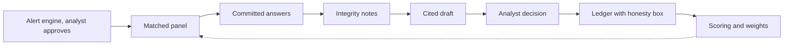

# Impact: who gains, what changes, why it matters

Lane C. Status: complete, revised for master prompt v3.4 (8 Nov). v3 changes reflected here: commitments instead of secrecy, equal-weight mean as the headline number, analyst-triggered pulses, descriptive integrity notes, scoring of forecasts not people, no countdown in the product, synthetic results as a sensitivity test.

Labels used in this file:
- **[data]** computed from `data/risk-radar-export.csv` by us.
- **[mentor]** from the ACAPS mentor interview, Fri 6 Nov (master prompt section 0a). These are our interview notes, not a verbatim transcript. Quotation marks mark wording we recorded as spoken.
- **[brief]** from the organisers' brief on `main`.
- **[assumption]** our design choice or guess. To be tested in the December pilot.

## 0. What the mentor told us (primary evidence)

1. Experts are "not sources on the ground". They are well-informed professionals who already track crises: think-tank analysts, journalists, researchers, early-warning practitioners. [mentor]
2. Expertise is geographic and thematic. An earthquake expert outside Venezuela is still the right person for a Venezuela earthquake. Experts' tags are recorded for the panel. [mentor] Design change since the interview (v3.3): experts never sign up on a portal. The analyst adds them from existing contacts and the committee approves them; credentials and masks are created at approval, server-side.
3. There is a gateway. ACAPS approves on credentials and track of work. It is "a trust system that builds over time". A committee of several ACAPS admins decides. The Risk Radar manager sits in France. [mentor]
4. His open question: a panel could lean one way, or be packed to steer funding. [mentor]
5. "We will get things wrong, like a prediction market; the point is honesty about it." [mentor]
6. Products never change automatically. The app is one validation layer among others. ACAPS must minimise bias and state limitations and what fed into each product. [mentor]
7. No platform exists. The old app died with the US funding cuts. Risk Radar is a dataset on the website plus an API that most heavy users pull into their own systems. He said Risk Radar "should have a platform" and that we may build one on the API to showcase the loop. [mentor]
8. Today 32 analysts track their countries' parameters daily, score risks manually with simple thresholds, and update weekly. "Not very automated, lots of space to improve." [mentor]

Questions we still owe Alex (from `questions-for-acaps.md`) and have no answer for: 4 (expert devices, languages), 5 (how much time per month), 6 (what killed earlier pools), 7 (who needs full anonymity), 11 (who approves the forecast question), 12 (who reads the list for funding), 13 (pilot shape). Every cell below that depends on one of these is marked [assumption].

---

## Part 1. Stakeholders

Five groups. For each: today, with Sealed Signals, what they get, how they want to give their view, what would make them stop.

### 1.1 ACAPS analysts (32 people, one per set of countries)

Persona link: none of the four personas. They are the product's moderators and the ones who must stay in charge.

**Today.** Each analyst tracks the parameters of their countries daily, scores risks by hand against simple thresholds, and updates weekly. [mentor] To check a view they call one or two experts or chat with peers. Those checks between scheduled reviews are not structured, time-stamped or auditable, so nobody can score them later. [brief, our reading]

**With Sealed Signals.**
- Each month the Risk Alert Engine compares ACAPS's own monthly severity and access editions for every crisis, links the result to the analyst's active risks, and proposes a ranked list of shifts with the rule that fired. The analyst approves a pulse or dismisses it with a note. The analyst can also ask the panel on any risk with one click. No model is involved in the alerts.
- A matched panel of up to 8 vetted experts answers in a minute each. Answers are committed with a timestamp and opened together.
- The analyst receives one screen: the equal-weight mean, spread and minority reasons, missing themes, descriptive integrity notes, and a cited draft update built from a fixed template. The analyst accepts, edits or rejects. Nothing publishes itself.

**What they get.**
- A number and the reasons behind it, with every claim cited to a panel aggregate, an indicator or an existing source.
- Moderator-only integrity notes: plain descriptions such as "round 2 answers moved toward the mean without new reasons" or "no displacement expert on this panel". They describe. They do not judge a person or change the number.
- A track record on resolved questions: how the panel's group forecast compared with the ACAPS Probability band, held committee-side.
- Less drafting time per weekly update. [assumption] We have not measured this. The pilot should time it.

**How they want to give their view.** At a desk, on a large screen, in English first. Decision in under five minutes per pulse. [assumption]

**What would make them stop.**
- A draft that cites something false, or an unsourced number. One bad citation costs trust for weeks.
- Extra work: a second system to maintain next to the weekly update.
- A tool that reads as a replacement for their judgement.
- Pulses that fire too often. Design limit: one pulse per expert per 7 days.

### 1.2 Vetted experts (analysts, journalists, researchers, early-warning practitioners)

Persona link (design hypotheses from ACAPS's personas, `personas.md`, not evidence): Jose, emergency specialist in a UN regional office who covers Sudan, is the expert the Chad pulse is built for. Pierre, a field MEAL officer, is the field expert for whom the voice-note and "outside my area" paths exist. Emily can be a panel member on health and nutrition. Every channel and cadence below is marked assumed, to verify in the pilot.

**Today.** Their knowledge reaches ACAPS through informal calls and chats. It is used once and not credited. They get nothing back. Earlier expert pools lost participation after launch. [brief] We do not yet know why in ACAPS's own experience (question 6).

**With Sealed Signals.**
- First contact is a personal note from the analyst, by name: why this expert, a one-line charter (what we ask, how often, what we store, who sees what), and "reply STOP at any time". The question follows in the same message. STOP is honoured within the hour. [assumed channel: email first, then WhatsApp, Signal, SMS, Teams or a scheduled call; to verify in the pilot]
- The card opens with the event, place, threshold and deadline. One input is required: a likelihood, a five-word scale with its percentage range printed under each word. Everything else is optional: confidence, one line on what is missing, a tag (saw, read or heard), the strongest reason it would not happen, a guess of what share of the panel will put the likelihood above 0.5. "Outside my expertise" and "not enough evidence" are real answers and are never scored.
- No severity line and no ACAPS rating before submission, so the first answer is the expert's own. Opening the link commits nothing: an explicit submit and a confirmation screen do. The expert can correct the answer until the deadline. There is no countdown in the product.
- The mask is chosen per answer, with no default: named to ACAPS, nickname to peers, or no identity kept. The product says pseudonymised, never anonymous, and warns that a distinctive reason can be recognised by colleagues on a small panel.
- All answers are revealed together at the deadline, never when five are in. With fewer than five at the deadline the panel is "insufficient": nothing is revealed and the analyst is told. Round 2 is optional and asynchronous, opens only with new evidence or real disagreement, and shows the anonymised spread only.

**What they get.**
- A thank-you built from the record only ("what your minute changed"): what the analyst decided, which decision it informed, for whom, by when. After the reveal and again on resolution, with the outcome. Everyone who answered gets it. Never a personal score or a ranking.
- Calibration only with consent: a separate programme, off by default, with a disclosure of what is measured, one-reply opt-in, and the report goes to the expert first and alone.
- Evidence that their view was heard: the ledger shows the group view and, later, the outcome.
- No streaks, no engagement counts. Scores belong to forecasts, are held committee-side, and never decide who is approved or removed.
- A reason to come back that is not a gamified one: the question is relevant to a place they follow.

**How they want to give their view.**
- Channel: email magic link first, WhatsApp second, as the master prompt sets. [assumption] To test at the pilot with real people.
- Language: English first, French next. Arabic is on the future list. [brief: French named as a working language]
- Time: a minute, on a phone, outside office hours as much as in them. One card, no countdown in the product. [assumption]

**What would make them stop.**
- A card that takes more than a minute or asks for a login.
- Any sign that their answer could be traced back when they chose a mask. We tell them plainly who can learn what (master prompt section 1a): ACAPS admins see answers with the mask chosen, the identity registry is restricted and every read is logged, and answers with no identity kept carry no identity link. Pseudonymised, not anonymous.
- Being asked too often. Cap: one pulse per expert per 7 days.
- Hearing nothing back. The group outcome report answers this.
- A panel they see as stacked, or an app that feels like a chatbot.
- Anything measured about them without consent. v3.4 removed hidden measurement from the pulse; the committee reads sentences about panels (three or more pulses, never a person), and individual calibration is a separate, consent-gated programme.

### 1.3 ACAPS readers (UN agencies, INGOs, donors such as ECHO, FCDO and CERF, insurers)

Persona link: Emily (donor methodology head who struggles to judge reliability), Aisha (INGO country director who wants anticipation of what comes next), Jose (UN regional head who wants field feedback to reach headquarters). [brief]

**Today.** They read the Risk List on the website or pull it through the API into their own systems. [mentor] A rating is a single analyst-set label. They cannot see how it was reached, how often ACAPS has been right, or whether people on the ground recognise the picture. [brief] Emily "has to go elsewhere to check it".

**With Sealed Signals.**
- Each Risk List entry can carry, next to the ACAPS rating, the panel's group view, committed at a stated time. A Verify button checks the timing and consistency of the round, nothing more.
- Every ledger entry has an honesty box: number of contributors, agreement, spread, coverage gaps, claims corroborated, queued for checking and total, the panel's hit rate and number of misses, a caveat line, what decision the view could inform (for whom, by when), and, when the analyst rejected the panel view, that fact and the analyst's reason.
- When the risk resolves, the outcome appears on the same entry.

**What they get.**
- For Emily: a stated basis for each number and a visible record of past errors.
- For Aisha: a view on what the people who follow a context expect, in numbers, and a stated view she can compare with the ACAPS rating. We make no claim that the panel moves before ACAPS: the export has no structured rating history to test that.
- For Jose: a documented channel through which his field teams' view can reach the analysis without exposing them. [assumption: only if his teams are admitted as experts]
- For donors and insurers: a stated group probability they can compare with ACAPS's own record once questions resolve. Today High-rated risks materialised 84 % of the time and Medium-rated 47 % [data: 32 of 38 and 27 of 58 resolved risks].

**How they want to give their view.** They do not contribute. They read, via the website, a ledger page or the existing API. [assumption] Public pages show aggregates only.

**What would make them stop.**
- Numbers that look precise but are wrong in a way nobody states.
- Any suggestion that funding decisions can be steered by whoever sits on the panel.
- A product that changes without notice. The ledger records every change and who decided it.

### 1.4 The ACAPS committee (several admins, global)

Persona link: none. This is the gatekeeper the mentor named. [mentor]

**Today.** No expert gateway exists as a formal process. Expert contacts are personal to each analyst. [assumption: inferred from "informal conversations with peers" in the brief]

**With Sealed Signals.**
- Applications arrive with tags. Approval needs two admins before a credential is issued.
- The committee sees panel composition against rules: no more than 3 of 8 from one affiliation tag, geographic spread, theme cover.
- It sees coverage gaps (a conflict risk with no conflict expert) and decides who to invite.
- It can pause an expert. Removing an expert never alters past ledger entries.
- It holds the key to the identity registry (encrypted at rest, every read logged and shown to the committee), issues blind-signed credentials in batches, and signs outcome attestations. Each carries a stated limit: an authorised admin can still read the registry, and the log shows that they did.

**What they get.** An audit trail of who was admitted, when and by whom; a defence against a packed panel; a reliable way to grow the pool by tag rather than by contact lists.

**How they want to give their view.** Committee screen on the desk. Two-person approval. Time: a short review session per week. [assumption]

**What would make them stop.** Admin workload with no payoff; a gateway that is too slow so good experts drop out; any pressure to approve someone without checks.

### 1.5 Affected populations (people in eastern Chad and in the next Risk List country)

Persona link: indirect. Aisha's 150-person team and Pierre's deployments act on their behalf.

**Today.** Humanitarian decisions use ACAPS risk ratings as one input among many. When the rating is late or uncalibrated, preparation starts late. [assumption, supported by the anticipatory-action evidence in part 3]

**With Sealed Signals.** They are not users and never see the app. Their interest is in downstream effects: an earlier and better-calibrated warning reaches the agencies that plan for them. This is a possibility, not a promise. Section 3 of this file sets out the chain and its weak links.

**What they get.** Nothing direct. We say so plainly. The case for impact rests on whether better forecasts change an agency's decision, which part 3 treats as the weakest link.

**Risks to them.** If an expert's identity leaks, the expert is in danger, and so are the people they work with. This is why confidentiality is chosen per answer and public output is aggregate only. Two limits we state: an aggregate with 5 or more contributions is a disclosure rule, not an anonymity guarantee, and on a small panel a distinctive reason can be recognised by peers.

**What would make us stop.** Any evidence that the tool exposes a contributor or biases attention toward places with more experts and away from places with fewer. The second is a real risk: contexts with few vetted experts get a thinner panel. The honesty box states this as a coverage gap.

---

## Summary table

| Group | Today | Main gain | Channel and time | Stops if |
|---|---|---|---|---|
| Analysts (32) | Manual scoring, weekly updates, informal calls [mentor] | One screen with cited draft and integrity checks | Desk, minutes per pulse [assumption] | Draft cites falsehood; extra workload |
| Experts | Informal chats, no feedback [brief] | Group outcome report, a heard view, opt-in calibration | Email link, then WhatsApp; about a minute [assumption] | Login, traceability, over-asking |
| Readers | One label, no visible basis [mentor] | Basis, record and outcome on each rating | Website, ledger, API [assumption] | Hidden errors; steering |
| Committee | No formal gateway [assumption] | Audit trail and composition rules | Desk, weekly [assumption] | Workload; pressure to admit |
| Affected people | Indirect | Possible earlier preparation | None | Leak of a contributor; thin panels |

---

## Part 2. Before and after

### 2.1 Today: ACAPS's own method, and where the gap is

Source: ACAPS risk methodology as shipped in the organisers' pack (`docs/risk-methodology.md`), which states a six-step analytical process, and ACAPS's analysis workflow poster (Design, Acquire, Analyse, Communicate) as quoted in master prompt section 0b. We did not find the poster itself on a public page in our search; the quotations come from the master prompt. Ratings are set by expert judgement, not calculated (ACAPS risk methodology brief, 2019).

| ACAPS step | What happens today | Where Sealed Signals touches it |
|---|---|---|
| 1 Monitor | Analysts track their countries' parameters daily [mentor] | Risk Alert Engine: month-over-month diff of ACAPS's own severity and access editions |
| 2 Identify | Events that could lead to deterioration are named, with triggers | Trigger pick on the card: which trigger would move the expert's view most |
| 3 Assess | Probability and impact set by judgement on a five-point scale | The pulse: an equal-weight panel view beside the ACAPS band, ACAPS rating hidden until submission |
| 4 Prioritise | Overall risk level set | Analyst accepts, edits or rejects the cited draft |
| 5 Disseminate | Website and API; updated weekly by hand [mentor] | Public ledger with honesty box, beside the ACAPS rating |
| 6 Review | Developments monitored, assessments updated, risks closed as materialised or not | Resolution against a frozen question contract; panel-level scoring; thank-you to every expert |

The gap, stated exactly: ACAPS has a documented methodology and peer review for its scheduled products. Ad-hoc expert checks between scheduled reviews are not structured, time-stamped or auditable. We do not say there is no record. We add a structured, time-stamped, auditable way to run those checks, and a public platform on the API that ACAPS does not have. [mentor]

### 2.2 After: the loop

Eight stages, each with one owner. Only the analyst's decision changes a rating.

```
 ALERT ENGINE ──> MATCHED PANEL ──> COMMITTED ANSWERS ──> INTEGRITY NOTES
 ACAPS monthly    up to 8 vetted     rating hidden until      descriptive, for the
 editions, ranked experts by         submission, mask per     analyst only
 shifts; analyst  geo + theme tag    answer, about a minute        │
 approves
                                                                    v
 SCORING  <──  LEDGER with  <──  ANALYST DECISION  <──  CITED DRAFT
 Brier,        HONESTY BOX       accept / edit /         fixed template, every
 committee-    public, Verify    reject (the only        sentence traceable;
 side; group   checks timing     step that changes       unchecked claims queued
 outcome       and consistency   a rating)
 report to all
```

The same loop in Mermaid, for GitHub and slides:



### 2.3 What changes, step by step

| Today | With Sealed Signals | Who gains |
|---|---|---|
| Analyst notices a shift by reading, then looks for someone to ask | The engine diffs ACAPS's own monthly severity and access editions for every crisis, ranks the moves, links them to active risks and shows the rule that fired. The analyst approves a pulse or dismisses it. Arithmetic on ACAPS data, no model. | Analysts |
| One or two experts, by phone | Up to 8 matched experts, ACAPS rating hidden until they submit, about a minute each | Analysts, experts |
| Expert answers live in an email thread or a chat | Answers are committed with a timestamp, so they cannot be changed afterwards and peers cannot see each other early. They are opened together. This does not hide them from the operator. | Readers, experts |
| Rating set by judgement alone | Panel number sits next to the rating. The analyst still decides. | Readers |
| Weekly manual rewrite | A cited draft from a fixed template. Every sentence names its aggregate, indicator or source. The analyst edits. Unsupported claims go to a queue. | Analysts |
| Checks between reviews are not structured, time-stamped or auditable | Brier score per forecast on resolved questions, panel-level, with the frozen question contract. Thank-you to everyone who answered. Individual calibration only with consent. | Experts, committee |
| No stated basis | Honesty box on every entry: what fed in, limits, misses, what decision it could inform, and when the analyst rejected the panel view | Readers |
| Dataset and API only | A platform on the API with the loop on top | All |

### 2.4 What the 32 analysts gain per week

We have not measured this. These are the saved steps we expect, to be timed in the December pilot. [assumption]
- No hunting for which expert to call: the panel is matched by tag.
- No chasing replies: pulses expire and the analyst sees who answered.
- A draft with citations replaces a blank page.
- Disagreement is shown, not summarised away.
- The closing record of hits and misses builds without extra entry.

Pilot measure: minutes per weekly update with and without the draft, for the same analyst on comparable risks.

### 2.5 What does not change

- ACAPS analysts decide. The committee administers. [mentor, master prompt rule 8]
- Public pages show aggregates, caveats and track record. Never flags about a person.
- AI works analyst-side only. Experts never talk to a model.

---

## Part 3. Impact chain, with evidence

Label for every figure: **cited** (with source), **[data]** (computed by us from the Risk Radar export), or **illustrative** (our own number to show the arithmetic; not a finding).

### 3.1 The chain

```
better-calibrated  ->  earlier       ->  anticipatory   ->  aid pre-      ->  lower cost
probability            decision          funds released     positioned        and mortality
(this product)         (donors,          (IFRC, WFP,        (stock, cash,     (outside this
                       agencies)         CERF triggers)     staff in place)   product)
```

Strength of each link:

| Link | Evidence | Strength |
|---|---|---|
| A panel mean gives a better probability than one rating | Aggregation literature in `bias-and-honesty.md`; Lane A's sensitivity test on synthetic panels | Plausible in general; **untested on real experts**. The sensitivity test says nothing about real experts. |
| Better probability gives an earlier decision | Reasoned only. No study of ACAPS ratings changing funding timing was found. | **Weak.** This is the link the pilot must test. |
| Earlier decision gives anticipatory funds | CERF, IFRC and WFP release money against pre-agreed triggers | Strong for weather-driven hazards, **thin for conflict and displacement** |
| Funds give pre-positioned aid | Evaluations below | Moderate, cited |
| Pre-positioned aid gives lower cost and mortality | Evaluations below; mortality evidence is thinner than cost evidence | Moderate on cost, weak on mortality |

Plain statement: the evidence in the right half of the chain comes mostly from floods, droughts and harsh winters, where forecasts trigger money. Conflict-driven risks such as R1043 have fewer formal triggers. We do not claim the same returns apply.

### 3.2 Cited evidence on anticipatory action

All items below were checked against the listed source pages on 6 Nov 2026 through search snippets. We did not read every full PDF. Re-check each before it appears on a slide.

1. WFP, FAO and OCHA, "Saving lives, time and money: evidence from anticipatory action", May 2025. Reports that evidence from Kenya, Bangladesh, Nepal and Somalia shows returns of up to USD 7 in avoided losses and added benefits per USD 1 invested. Source: [PreventionWeb record](https://www.preventionweb.net/publication/saving-lives-time-and-money-evidence-anticipatory-action-may-2025); PDF on [docs.wfp.org](https://docs.wfp.org/api/documents/WFP-0000166327/download).
2. Same report, Mongolia: anticipatory action for the 2017/18 harsh winter (dzud) was implemented four months before the standard emergency response.
3. Same report, Bangladesh: about 500,000 people reached ahead of peak monsoon flooding in the Jamuna basin. Summaries say within five days of the warning. FAO and PreventionWeb word the attribution differently, so we quote only "about 500,000 reached before peak flooding" and check the PDF before saying more.
4. FAO household-survey calculation for El Nino: up to USD 3 returned per USD 1 invested ([FAO newsroom](https://www.fao.org/newsroom/story/ready-set-anticipate/en)); regional FAO good-practice page puts the Latin America and Caribbean average at USD 2.34 per USD 1 ([FAO KORE](https://www.fao.org/in-action/kore/good-practices/good-practices-details/en/c/1759081/)).
5. Caveat from the Anticipation Hub synthesis: methods for cost-effectiveness and return on investment vary between studies, so figures are not directly comparable ([Anticipation Hub](https://www.anticipation-hub.org/news/building-the-evidence-for-anticipatory-action-what-weve-learned-and-whats-next)).
6. Mechanism: CERF anticipatory action frameworks release funds when a pre-agreed trigger is reached. In 2020 a forecast of severe Jamuna floods led CERF to allocate USD 5.2 million in Bangladesh. IFRC DREF early action protocols work the same way, with triggers set in advance. Source: [CERF overview](https://cerf.un.org/sites/default/files/resources/CERF_Atforefront_AA.pdf); [Centre for Humanitarian Data](https://centre.humdata.org/anticipatory-action-in-bangladesh-before-peak-monsoon-flooding/).

Dropped, not cited: the "half the cost of previous responses" claim for Bangladesh. It appeared in one summary and we could not confirm it in the report.

### 3.3 ACAPS numbers

From the Risk Radar export [data]:
- 139 risks, 57 countries, 104 resolved, 28 active.
- Among resolved risks, **High-rated: 32 of 38 materialised (84 %)**. **Medium-rated: 27 of 58 (47 %)**. Low-rated: 3 resolved only, too few to use. The ACAPS data dictionary gives the same rates.
- What this means for a user: a Medium rating is close to a coin flip. A funder cannot tell from "Medium" whether to act. Panel input and a stated probability are most useful in this band.
- Brier score of the ACAPS rating mapped to a probability (Very Low 0.1, Low 0.3, Medium 0.5, High 0.7, Very High 0.9), on the 99 resolved risks that carry a probability rating: **0.213**. A forecaster who always says 0.5 scores 0.25. Lower is better. Our computation; the mapping is a convention from the master prompt, not an ACAPS statement.
- Caveat from the brief: older imported records resolve over much longer periods than the six-month horizon, so these rates mix time frames. [brief]

### 3.4 Worked example: R1043, eastern Chad

Facts from the export [data, R1043 record]:
- Title: escalating cross-border insecurity linked to the Sudan conflict, eastern Chad.
- Rated Probability High, Impact 4, Risk Level High, trend Deteriorated, status Active.
- Expected exposure: more than 500,000 people.
- Priority needs: Protection, Food security, Livelihoods, Health.
- Update of 30 Sep 2026: more than 400 Sudanese refugees per day crossing by 25 Sep, about 20 times the earlier rate; more than 55,000 arrivals since the start of 2026.
- The first trigger (T0618) is expansion of cross-border attacks around Adré, Tine and other border localities.

Refugee figure, updated 7 Nov 2026: UNHCR registers 1,425,743 Sudanese refugees in Chad (data date 2026-11-02; [UNHCR Operational Data Portal, Chad](https://data.unhcr.org/en/country/tcd)). This is the national total for Sudanese refugees. It includes people who arrived before April 2023 and is not an eastern-Chad-only figure. The master prompt line "over a million Sudanese refugees in eastern Chad since 2023" is therefore too loose: use "about 1.4 million Sudanese refugees registered in Chad (UNHCR, 2 Nov 2026)". The earlier "800,000 to 870,000 by mid-2025" figure is out of date.

**What the loop would do (illustrative):**

1. Alert: replaying the April 2026 edition, the engine ranks crisis TCD005 (Displacement from Sudan to Chad) first of 123 for the rise in its INFORM Severity Index (6.1 to 6.9; Human Impact 6.0 to 7.6) [data: cached ACAPS editions, checked 7 Nov]. The analyst has confirmed the link between TCD005 and R1043 and approves a pulse. Note: TCD005 is the displacement crisis; R1043 is about cross-border insecurity. The alert is a nearby signal, not a measurement of R1043 itself, and the pulse says so.
2. Panel: up to 8 experts tagged for Chad or neighbouring Sudan and conflict or displacement answer in about a minute each, with the ACAPS rating hidden until they submit.
3. Suppose the equal-weight mean is 0.74, the range is 0.45 to 0.90, and one minority reason says displacement is the larger risk. ACAPS's High maps to 0.7 (a stated assumption). **These numbers are illustrative.**
4. Analyst receives a cited draft: probability 0.74 (High), with one claim in the verification queue. Absence from the checked databases is not evidence the claim is false.
5. Analyst accepts. The ledger records the group view, the honesty box (including the decision it could inform, for whom, by when) and a Verify hash.

**Why the number matters (illustrative arithmetic).** A planner will act early when the probability p is above the ratio of early cost to late cost.
- Suppose early action costs USD 20 per person and the same help after the shock costs USD 40 per person. Ratio 0.5. **Illustrative.**
- Suppose a plan covers 50,000 people (a fraction of the exposed population above). **Illustrative.**
- Early action costs 50,000 x 20 = USD 1.0 million, spent whether or not the shock comes.
- Waiting costs p x 50,000 x 40 = p x USD 2.0 million in expectation.
- At p = 0.78: waiting costs USD 1.56 million. Acting early saves USD 0.56 million in expectation.
- At p = 0.70: waiting costs USD 1.40 million. Saves USD 0.40 million.
- At p = 0.45: waiting costs USD 0.90 million. Waiting is cheaper by USD 0.10 million.

The point is the flip: with this ratio, a Medium rating sitting at 0.45 to 0.5 gives no answer, and a 0.1 error in p changes the decision. We do not claim these costs are real. We claim that calibration decides which side of the line a planner lands on. That is why the product scores every forecast.

What would have to be true for impact: (a) the panel is better calibrated than the rating alone; (b) a donor or agency changes timing because of it; (c) a funding mechanism exists for a conflict-driven risk. The pilot can test (a) and part of (b). It cannot test (c).

### 3.4a The alert signal for R1043 (ACAPS monthly data) [data]

Checked by us in the cached editions (`data/acaps-api/`), 7 Nov 2026:
- TCD005 "Displacement from Sudan to Chad" (Ennedi Est, Wadi Fira, Ouaddai, Sila; connected to SDN001): INFORM Severity Index 6.1 (edition last updated 28 Feb) to 6.9 (29 Apr), category High both months; Human Impact 6.04 to 7.57; Conditions of affected people 6.52 to 7.55; People in need 7.04 to 7.11; Reliability Very High.
- The +0.8 is the largest **rise** among the 123 crises present in both editions. By absolute change it ranks second: PAK007 fell by 0.9. Say "largest rise", not "largest move".
- The November edition (updated 27 Oct) shows TCD005 at 7.1.
- Under our reading of the rules (index rise of 0.5 or more, or any component moving by 1.0 or more in either direction, or a category change), 9 of 123 crises would have fired between March and April, and 0 of 122 between October and November. Two month pairs is too few to call a typical rate, and Lane A's code defines the rule, not us. Use this only as a rough sense of analyst workload.
- Timing: R1043 was entered into the Risk Radar on 2 June 2026 [data: "Date entered" in its trigger text]. The April edition would have fired the rule about five weeks earlier. We do not turn this into a claim that ACAPS was late: analysts may have known, the engine and the risk are different products, and the export has no structured rating history. We say "this is what the engine would have proposed".

### 3.5 What we will not claim

- That the tool reduces mortality. We have no evidence of that.
- That ROI figures from floods and droughts apply to Chad.
- That the sensitivity test shows experts are accurate, or that the panel moves earlier than ACAPS. It tests the software on synthetic panels. The export has no structured rating history, so no timing claim can be made.

### 3.6 Pilot measures that would close the gaps

| Gap | Measure in a two-month pilot |
|---|---|
| Is the panel better than the rating? | Brier of the panel mean vs the ACAPS Probability band (mapped to numbers, stated assumption) on questions that resolve inside the pilot. Two months will yield few resolutions, so report counts, not significance. |
| Does it save analyst time? | Minutes per weekly update with and without the draft |
| Will experts stay? | Share of pulses answered; share of approved experts still answering in week 8; no time-in-app metric |
| Do readers use it? | Number of readers who open the ledger entry; reader interviews with two personas |
| Does anyone act earlier? | Interviews with one donor or agency on whether the panel view changed timing |
